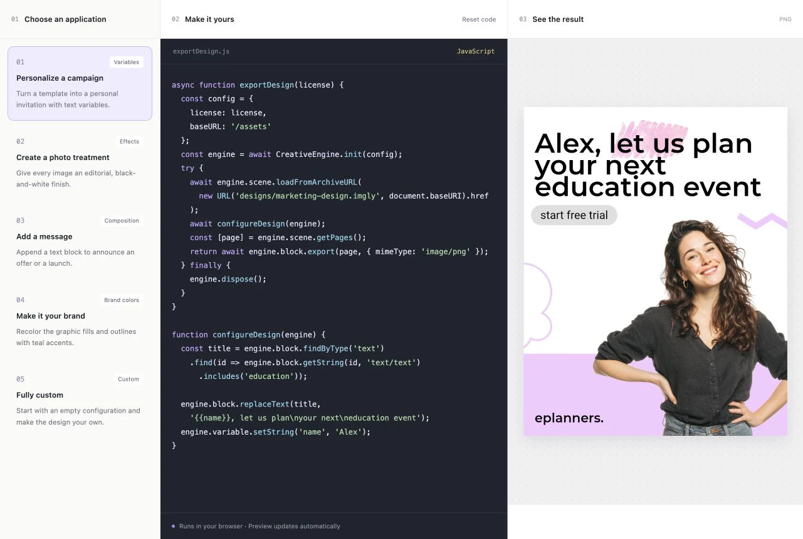

# Headless Design Engine Starter Kit

Photo/video editing capabilities with CE.SDK without mounting an editor. Explore five applications, edit sandboxed JavaScript, and see your changes exported automatically.

The five applications personalize text with variables, apply photo effects, append a text block, change brand colors, and provide an empty configuration for custom code. Every export loads a fresh copy of the marketing design used by the Design Editor starter kit. The `.imgly` archive bundles the design, images, and fonts.



## New project

```sh
npx degit imgly/starterkit-headless-ts-web starterkit-headless
cd starterkit-headless
npm install
mkdir -p public
cp -R node_modules/@cesdk/engine/assets public/assets
npm run dev
```

Set your license in `src/demo.ts`. The demo passes it to `exportDesign(license)` so the editable source contains no embedded key. Internal previews use `VITE_CESDK_LICENSE`, like the other starter kits. For the reusable TypeScript workflow outside the playground, pass your license to `exportDesign(license)` directly. Request a license from [IMG.LY](https://img.ly/forms/contact-sales/). Keep the engine assets on the installed engine version; `baseURL` points to their location.

## Existing project

Install `@cesdk/engine` and copy `src/imgly/` into your application. `exportDesign(license)` receives your license as a string argument; the engine asset location and design URL remain explicit inside the function. For your own interface, replace the `#code` textarea lookup in `src/imgly/configure-design.ts` with your JavaScript source defining `configureDesign()`, then call `exportDesign(license)` from an export handler. Handle rejection and consume the returned PNG Blob.

To reuse the complete demo, also copy `src/demo.ts`, `src/presets.ts`, `src/highlight-code.ts`, `src/style.css`, and `public/designs/`. Import the stylesheet and call `mountDemo(root)` with an empty root element. Keep `designs/` next to the entry URL, or change the URL literal inside `exportDesign(license)` to your public archive location, including any deployment prefix. Packaged Electron renderers should use an absolute HTTP(S) archive URL. Call the returned cleanup function on unmount.

[Framework guides](https://img.ly/docs/cesdk/js/starterkits/headless-hdls01/) cover the New Project and Existing Project paths for all supported Web frameworks.

## Explore the demo

1. Select an application on the left.
2. Edit both `exportDesign(license)` and `configureDesign(engine)` together in the single, syntax-highlighted code editor. The export function includes `CreativeEngine.init()` and `engine.dispose()` in `finally`. Switching applications loads its complete example; **Reset code** restores both functions.
3. Watch the preview update automatically on load, preset selection, reset, and after a 400ms pause in editing.

Only one export runs at a time. New requests replace the pending source. An active export finishes and disposes its engine before the latest source runs; superseded results and errors are discarded. The previous result stays visible until the latest export succeeds. Errors appear as plain text below the preview; edit the code to clear the message and retry automatically. The latest started export promise is available as `window.headlessExport`.

## Browser execution and engine lifetime

`src/imgly/index.ts` owns engine creation, loading, export, and disposal. The UI provides an editable JavaScript version of this workflow together with the configuration in one code field. `src/imgly/run-design.ts` executes the complete source and calls the edited `exportDesign(license)`. `CreativeEngine` is provided to the code, so use plain JavaScript without imports or TypeScript annotations. Keep the PNG Blob return value and engine disposal in `finally`. `exportDesign(license)` calls `await configureDesign(engine)` directly. `src/imgly/configure-design.ts` reads the edited JavaScript and executes it in the browser, awaiting async configuration before export. CE.SDK's canvas stays detached from the DOM.

The edited function receives the current engine instance and runs in the page's browser context with access to browser APIs. It uses the regular engine API without an additional engine sandbox or execution limits. Each run starts from a fresh archive, and the engine is disposed in `finally`, including on errors. The UI releases result object URLs on replacement or unmount, cancels pending debounce timers, and ignores work that completes after teardown.

## Build and deploy

```sh
npm run build
npm run preview
```

Serve the built files, `designs/`, and matching engine assets over HTTP(S), with a license for your deployment origin. The kit uses only `@cesdk/engine` at runtime; it does not mount the editor or depend on `@cesdk/cesdk-js`. This browser engine requires WebGL and a DOM. A DOM-free server requires a server engine package.

If your application sets a Content Security Policy, include `'unsafe-eval'` in `script-src` for the editable JavaScript demo. A fixed configuration function can be called directly without runtime compilation.

## Files

- `src/imgly/index.ts`: engine creation, configuration, export, and disposal with a supplied license.
- `src/imgly/run-design.ts`: executes both edited functions on export.
- `src/imgly/configure-design.ts`: browser execution of the edited configuration.
- `src/presets.ts`: five editable application examples.
- `src/highlight-code.ts`: escaped JavaScript syntax highlighting for the code editor.
- `src/demo.ts`: controls, preview, and inline errors.
- `src/style.css`: responsive three-panel layout.
- `src/index.ts`: host configuration and mounting.
- `public/designs/marketing-design.imgly`: bundled marketing template from the Design Editor kit.

## License

The starter-kit source uses the included MIT license. CE.SDK is a commercial product and requires its own license.
